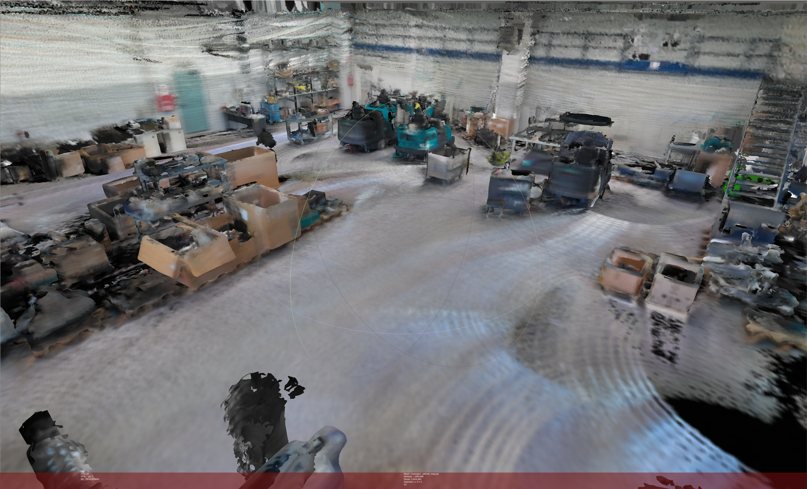

# Finer-detail RGB mesh via TSDF fusion



This is a second, independent reconstruction of the same environment as
[`../coverage1_edited/`](../coverage1_edited/), built to get past that
pipeline's main limitation: GLIM's saved map only keeps a downsampled point
cloud (149,813 points, ~6.35 cm median spacing), so no meshing algorithm run
on it can recover detail finer than that spacing.

Instead of reading GLIM's saved map, this pipeline goes back to the original
ROS 2 bag and re-derives everything from the **raw sensor stream**: every
`/ouster/points` scan (full ~60k points/revolution instead of GLIM's
decimated keyframe map) plus the `/rgb/image_raw` camera feed, fused with
GLIM's own solved trajectory. It also switches reconstruction algorithm, from
screened Poisson (which fits an implicit function to oriented points and can
extrapolate across gaps) to **TSDF volumetric fusion** (which only ever
records what was actually observed along real sensor rays), and adds
photographic RGB colour where the camera saw a point, instead of grayscale
LiDAR intensity only. The one deliberate exception is the floor: since the
map is meant for simulation, the measured floor is not fused but replaced by
a smooth synthetic floor surface lying exactly on the fitted floor model,
coloured from the floor points (step 4).

`build_finer_map.py <name>` fuses the raw bag into
`outputs/<name>/<name>_finer_mesh.ply` (binary PLY with per-vertex RGB),
estimating the floor on the way, discarding below-floor returns and
replacing the measured floor with a smooth, coloured synthetic floor.

See the `finer_map_report.json` next to the mesh for the exact figures
behind it. The build writes a single PLY (fused objects + synthetic floor).
See "Visualizing the output" below for how to view it.

`map_refinement.py <name>` then turns that PLY into a simulation map, in
about a minute and without the bag or the TSDF. It runs a chain of steps:
1. Remove broken triangles, everything close to the ceiling, and small
   floating fragments.
2. Enclose the map in walls and a roof fitted to the floor's outline.
3. Complete the floor up to the walls.
4. Clip everything outside the walls.

The result is exported as a ready-to-load Gazebo Harmonic model with a
detailed textured visual mesh and a very coarse collision mesh. See
"Map refinement" below.

## Why this needed raw data, not GLIM's saved map

| | `coverage1_edited` (Poisson) | `finer_mapping` (TSDF, this pipeline) |
|---|---|---|
| Point source | GLIM's saved, decimated submap points | Raw `/ouster/points` from the bag |
| Points used | 149,813 | tens of millions (every valid raw return) |
| Median point spacing | ~6.35 cm | limited by the sensor's own angular resolution, well under 6.35 cm at typical room range |
| Colour | LiDAR intensity (grayscale) only | Camera RGB where visible, intensity grayscale fallback |
| Reconstruction | Screened Poisson (PCL) | TSDF volumetric fusion (custom, this pipeline) |
| Extrapolation behaviour | Can bridge gaps with a plausible-looking but unmeasured surface (trimmed afterwards to 20 cm of source data) | Only ever produces surface within one voxel of somewhere a ray actually terminated, except the floor, which is a modelled plane filling the whole floor outline |

GLIM's own map storage is intentionally decimated for real-time SLAM, so
`coverage1_edited`'s 6.35 cm spacing is a hard ceiling on Poisson's output no
matter how the mesh is post-processed. Rebuilding from the raw bag removes
that ceiling; the sensor's own angular resolution becomes the limit instead.

## Source data

- **Bag:** `/home/autosweep/autosweep/dataset22jul/coverage1_lipede/` (the pipeline
  always plays the `_lipede` recording; it has the same start time and message
  count as the plain `coverage1/coverage1.db3`)
  (identified as the source for `coverage1_edited` by matching epoch
  timestamps: the bag starts at 1784717473.91s and `traj_lidar.txt`'s samples
  fall inside the bag's [start, start+311s] window).
- **Trajectory:** `coverage1_edited/traj_lidar.txt` — GLIM's global-mapping
  (loop-closure-corrected) LiDAR trajectory, TUM format (`t x y z qx qy qz
  qw`), 2,466 poses at ~100 ms spacing covering a continuous 300.5 s span
  with no gap over 0.5 s.
- **Calibration:** `coverage1_edited/config/config_sensors.json` —
  `T_lidar_camera` extrinsic, camera intrinsics/distortion
  (`rational_polynomial`, 8 coefficients, OpenCV-compatible order). Verified
  against the bag's own `/tf_static` (`T_lidar_imu` matches the recorded
  `os_sensor -> os_imu` transform exactly) and against GLIM's own
  `image_frame: rgb_camera_link` convention.
- **Sensor:** Ouster LiDAR at `/ouster/points` (organized `PointCloud2`,
  64 rings x 1024 columns/revolution, ~10 Hz, fields include `x y z
  intensity t ring range`) and an RGB camera at `/rgb/image_raw`
  (2048x1536, `bgra8`, ~9.3 Hz).

Only points whose timestamp falls inside the trajectory's covered time range
are used — the raw bag starts about 10.6 s before GLIM's first solved pose
(before enough data had accumulated to initialize global mapping), and those
early scans are skipped rather than extrapolated.

## Sensor time offsets (LiDAR and camera)

Both sensors' timestamps need a correction before scans, images and GLIM's
trajectory line up in time.

| Sensor | Problem | Correction | Value (coverage1) | Set by |
|---|---|---|---|---|
| LiDAR (`/ouster/points`) | The driver stamps each scan with the *previous* scan's time | capture time = header stamp **+ 0.09 s** | +0.09 s | `--points-time-offset`, default read from the GLIM map's `config/config_ros.json` (`points_time_offset`) |
| Camera (`/rgb/image_raw`) | Frames are stamped ~60 ms *after* capture | capture time = header stamp **− 0.06 s** | −0.06 s | `--image-time-offset` (default −0.06), measured with `measure_camera_time_offset.py` |

- **LiDAR offset:** it has to match the one GLIM was run with. GLIM adds
  it to every scan's stamp, so its trajectory is in that corrected clock.
  This is checked against the data: GLIM map `coverage1_off009` (run with
  0.09 s) has every trajectory keyframe stamped exactly at a scan's header
  stamp + 0.09 s. With that offset, turning scans line up best
  (2.4 cm median scan-to-scan distance, against 4.1 cm with no offset).
- **Camera offset:** it is measured against that same corrected
  trajectory, by projecting the LiDAR's object outlines into frames taken
  while turning and finding the time shift that lands them on the image
  edges. The −0.06 s is specific to this camera and driver; for another
  setup, re-run `measure_camera_time_offset.py`.
- **Where they're used:** both are logged at the start of a build and
  recorded in `finer_map_report.json` (`points_time_offset_s`,
  `image_time_offset_s`). Details are in pipeline steps 2 (LiDAR) and 5
  (camera) below, and in "Measuring the camera time offset".
- **Earlier builds:** a GLIM map built without the LiDAR offset (such as
  `glim_maps/coverage1`) gets 0 from its config, so the build behaves as
  before for that map.

## Pipeline (`build_finer_map.py`)

Passes over the bag: (1) cache camera frames, (2) estimate an intensity
normalisation range, (3) estimate the floor, (4) fuse every scan.

### 1. Trajectory interpolation (`src/trajectory.py`)

`traj_lidar.txt` gives `T_world_lidar` (world <- LiDAR/`os_sensor`) at ~100 ms
steps. Any in-between pose is obtained by linearly interpolating position and
spherically interpolating (slerp) orientation between the two bracketing
samples — accurate here because 100 ms is already fine compared to how fast
the platform moves.

### 2. Per-column deskewing, not per-scan (`src/ouster_scan.py`, `build_finer_map.py`)

A LiDAR "scan" is a full 360 deg revolution, so its first and last points
are up to ~100 ms apart — assigning every point in a scan the same pose
(what GLIM's own saved keyframe poses effectively give you) smears moving-
platform motion into the geometry. This pipeline instead reads the Ouster
`t` field (a per-point capture-time offset within the scan) to interpolate a
*separate* trajectory pose for every column. Since Ouster fires all 64 beams
in a column simultaneously (confirmed directly against the raw bag: the `t`
field is identical across all rows for a fixed column), this only costs one
trajectory interpolation per column (1024) rather than per point (~65,000).

**LiDAR time offset.** The Ouster driver stamps each scan with the
*previous* scan's time, so header stamps lag the real capture time by about
one revolution. GLIM corrects this with `glim_ros.points_time_offset`, which
it adds to every point cloud's header stamp; its trajectory
(`traj_lidar.txt`) is then stamped in that corrected time. The scans must be
read the same way, or every pose is looked up 0.09 s off.

- **The correction:** a point's capture time is `header stamp + offset +
  column t`. `--points-time-offset` sets the offset. By default it is read
  from the GLIM map's own `config/config_ros.json`, so it always matches the
  trajectory being used, and it is 0 if that file doesn't set it.
- **Everything follows from the corrected time:** trajectory interpolation
  and deskewing, the trajectory-coverage check, floor estimation, and the
  choice of camera frame for colour. Camera stamps are not affected.
- **Recording:** the value and where it came from are logged and recorded
  in `finer_map_report.json` (`points_time_offset_s`,
  `points_time_offset_source`).
- **Verified on coverage1.** With GLIM run at 0.09 s
  (`glim_maps/coverage1_off009`), every trajectory keyframe is stamped
  exactly at a scan's header stamp + 0.09 s. The earlier map
  (`coverage1`, offset 0) matches header + 0.
- **Effect on geometry:** scans 0.6 s apart while the robot turns at
  ~40°/s line up best at +0.09 s, with a median scan-to-scan distance of
  2.4 cm against 4.1 cm at 0. The error grows on both sides: 3.3 cm at
  0.045 s and 0.135 s, and 4.1 cm at 0.18 s.

### 3. Organized-cloud preprocessing (`src/ouster_scan.py`)

Ouster's `PointCloud2` is published *organized*: message height = 64 equals
the ring count, and row index equals the `ring` field exactly (also checked
directly). That structure is used for two things a plain unordered point
cloud can't do cheaply:

- **Edge/mixed-pixel filtering** — at a depth discontinuity (e.g. a doorframe
  in front of a far wall), some LiDAR returns fall roughly halfway between
  the near and far surface and don't correspond to anything real. Comparing
  each point's range to its immediate azimuth neighbours *within the same
  ring* (an O(1) array lookup thanks to the organized layout, no KNN search
  needed) flags and drops these before they corrupt the TSDF.
- **Incidence-angle weighting** — a cheap per-point normal from
  finite-differencing neighbouring beams (row and column direction) gives an
  estimate of how face-on each return was. Grazing-angle returns (surface
  nearly parallel to the ray) are noisier and get down-weighted in the TSDF
  fusion (clipped to [0.2, 1.0], never dropped outright).

Invalid returns (`range == 0`, arriving as NaN x/y/z from the ROS driver)
are always excluded.

**Per-ring min-range for the bottom rings.** Ring index correlates directly
with beam elevation: sampling `coverage1_lipede` every 15th scan, per-ring
median range falls monotonically from ~9.9 m at ring 0 (near-horizontal) to
~1.75 m at ring 63 (steepest downward) — expected, since the steepest beams
hit the floor closest to the sensor. Within rings 60-63 specifically, a
narrow band of ~120 `(ring, column)` cells sits noticeably closer than even
that ring's own floor baseline (e.g. ring 63's floor median is 1.75 m, but a
cluster there sits at 0.35-0.55 m) and recurs at nearly the same azimuths in
80-90%+ of scans - almost certainly the robot's own chassis/wheel/brush
rather than mapped environment, since real scene geometry wouldn't stay
that close at a fixed bearing for the entire trajectory. The global
`--min-range` (0.5 m) sits *inside* that cluster's range, so part of it
(0.5-0.66 m) survived filtering and got fused every scan - and because a
near-constant LiDAR-local offset deskews to world coordinates as
`R @ small_offset + t`, it stayed close to the sensor position `t` itself,
tracing something close to the trajectory shape in the output mesh.
`--bottom-rings`/`--bottom-ring-min-range` raises the cutoff to 0.8 m for
just the last 4 rings (clearing the observed cluster with margin) rather
than raising `--min-range` globally, which would also discard legitimate
close-up detail the upper rings pick up near walls and furniture.

### 4. Floor estimation, below-floor rejection and the synthetic floor (`src/floor.py`, `src/floor_slab.py`)

Points below the floor are not real geometry: they are mostly LiDAR
multipath returns (the beam bounces off a glossy floor and the sensor records
a point "inside" it) plus noise. In the earlier coverage1 build
(`outputs/coverage1_first/`), 13.6% of the mesh vertices sat more than
5 cm under the floor and 5.4% more than 30 cm under it; with this filter
(before the floor was replaced by a synthetic one) that dropped to 0.1% and 0%. They are removed *before* fusion rather than cut
out of the mesh afterwards, so they never create surfaces or blend into
colours in the first place.

The floor cannot be a fixed world-z cutoff: GLIM's world frame is not
gravity-aligned (coverage1's floor is tilted ~2.0 deg in it; the LiDAR's own
z-axis in world coordinates is tilted the same way), and over the whole map
the floor also drifts a few cm away from any one plane. So the model is a
global plane plus a coarse per-cell height correction, estimated from every
`--floor-sample-stride`-th scan:

1. **Candidates**: points whose organized-cloud normal is within 15 deg of the
   sensor's up axis and that lie within 4 m (horizontally) of the sensor that
   measured them. The robot drives on the floor, so near the sensor the
   dominant horizontal surface *is* the floor.
2. **Mounting height**: a histogram of candidate heights relative to their own
   sensor position peaks at minus the sensor's mounting height (0.605 m on
   coverage1); only candidates within 15 cm of the peak are kept. Being
   relative to the sensor at capture time, this step is immune to trajectory
   drift in z.
3. **Global plane, RANSAC then SVD**: SVD is a least-squares fit, so on its
   own the below-floor outliers this is meant to remove would drag the plane
   down. RANSAC (normals constrained to within 10 deg of the sensor's up axis)
   finds the inlier set, then SVD on the inliers alone gives the precise
   plane (coverage1: 2.4 cm inlier residual std over the whole map, which the
   per-cell correction then takes up; floor vertices end up a median 0.8 cm
   from the model).
4. **Per-cell correction**: the median residual of near-plane candidates in
   each `--floor-cell-size` (1 m) cell, filled from the nearest measured cell
   where there were none, median-filtered and clamped to +/-8 cm, then
   bilinearly interpolated so there are no steps at cell edges.

During fusion, points more than `--floor-margin` (5 cm) below that local floor
are dropped; `--ceiling-height` optionally drops points more than that far
above it too. The model is saved as `floor_model.npz` next to the mesh (reusable
by another build via `--floor-model`), and summarised
in `finer_map_report.json`.

**The floor is not fused; a synthetic floor replaces it** (`src/floor_slab.py`).
The map is meant for simulation, where the floor should be a clean, smooth
surface, and a fused floor is never quite one. It also keeps anything left
on it (the feet of people who walked by) joined to it. So during fusion a point within
`--floor-band` (5 cm) of the local floor whose normal is within
`--floor-normal-angle` (30 deg) of the floor normal (or that has no valid
normal) counts as floor and is **not integrated**. Points near the floor
that face sideways (the bases of walls, furniture legs) are fused as usual,
so objects still reach down to the floor. Floor points are still used for
two things:

- **Carving.** Their rays sweep the space just above the floor, and since
  there is no fused floor to protect, a ray that hit the floor carves right
  down to one voxel short of it (see step 6), which clears what people left
  behind close to the floor.
- **Colour.** Their colour (RGB-first, same weighting as step 5) is
  accumulated into a 2-D grid of voxel-sized cells in world xy.

After fusion, the cells that saw floor, closed over gaps up to
`--floor-fill-radius` (15 cm), with enclosed holes (under furniture, unseen
patches) filled and only the largest connected region kept, give the map's
floor outline. Over it the build adds the synthetic floor, with a vertex on
every voxel-cell corner and per-vertex colour from the grid (cells without
floor colour of their own take the nearest one's). By default
(`--floor-slab-top model`) it is a **single upward-facing surface lying
exactly on the floor model**: the global plane plus the per-cell correction,
which is median-filtered and bilinearly interpolated, so the surface is
smooth with no steps. It is not one perfect plane (on coverage1 it stays
within -3 to +7 cm of the global plane, from GLIM drift or real
unevenness), but walls and objects, which were fused down to the real local
floor, meet it with no gaps and without sinking into it, and there are no
extra layers or margins.

Two alternatives make it a **closed flat slab** (top and bottom faces
parallel to the global plane, side walls along the outline):
`--floor-slab-top highest` puts the top at the measured floor's highest point
(+7.2 cm on coverage1), so every wall and object base ends inside the slab,
at the cost of objects on the lowest parts of the floor looking up to about
10 cm shorter; `--floor-slab-top plane` puts it on the global plane (leaving
gaps of up to 7 cm under walls where the floor is higher). The bottom face
is at the measured floor's lowest point minus `--floor-margin`, or
`--floor-slab-thickness` below the top. A slab shows as two parallel floor
layers in a viewer (its top and bottom faces).

The synthetic floor is merged with the fused geometry into the build's only
mesh output, `<name>_finer_mesh.ply`. Nothing is cut where the two overlap:
a few fused leftovers near the floor (and, with a flat slab, wall and object
bases) can lie slightly below the floor surface, hidden under it. That is
harmless for rendering, LiDAR/depth simulation and static collision, but the
merged mesh is not one watertight solid.

**Output frame: z = 0 on the floor.** The output mesh is shifted along z only
(no rotation), so the synthetic floor's top surface is exactly at z = 0 under
the GLIM origin (the robot's start pose); x and y are GLIM's. On coverage1
the shift is +0.5002 m with the default floor surface (+0.4375 m with
`--floor-slab-top highest`). Because the floor is tilted ~2 deg in GLIM's
frame and the mesh is not rotated, the floor is only at z = 0 there: across
the map it lies up to about +/-0.4 m from z = 0. The shift is recorded as
`output_z_offset_m` in `finer_map_report.json` (add it to a GLIM z, e.g. of
the trajectory, to get output coordinates); everything else in the report,
and `floor_model.npz`, stays in GLIM's frame, since `--floor-model` is reused
for fusion.

### 5. Colourisation, RGB-first (`src/colorizer.py`)

`cache_frames()` walks the bag once and saves every `/rgb/image_raw` frame to
disk as JPEG plus a timestamp index (`cache/<name>/frames/`, `cache/<name>/timestamps.npy`)
so the fusion pass never holds more than a handful of full-resolution frames
in memory.

For each scan column, the camera frame closest in time (within
`--max-image-dt`, default 90 ms) is looked up. Deskewed world-frame points
are projected into that frame using the calibrated extrinsic
(`T_lidar_camera`) evaluated at *the image's own capture time* (not the
LiDAR column's time — the camera moved between those two instants too) and
the rational-polynomial distortion model, via `cv2.projectPoints` directly
against the raw (not undistorted) image. A per-scan z-buffer keeps only the
nearest-camera-depth point per output pixel — since the LiDAR and camera are
rigidly co-mounted, a single scan's own points already share close to the
matched image's viewpoint, so this catches ordinary self-occlusion (e.g. a
near wall vs. the corridor behind it) without needing a full-scene renderer.
It will *not* catch occlusion from geometry outside the current scan (e.g. a
thin object mapped in an earlier scan that no longer occludes now) — a known,
documented limitation, not a silent one.

**Camera time offset.** "The image's own capture time" is its header stamp
plus `--image-time-offset`. The camera driver stamps frames about 60 ms
*after* capture, so the default is −0.06 s.

- **Where it applies:** to the cached stamps when they are loaded. The
  cache itself keeps the raw stamps and doesn't need rebuilding.
- **What it affects:** both the choice of frame for each scan column and
  the camera pose the points are projected from.
- **Why it matters:** the camera pose comes from GLIM's trajectory, which
  is in the corrected LiDAR clock (see the LiDAR time offset in step 2). A
  frame stamped 60 ms late is projected from where the camera was 60 ms
  later. While the robot turns at 40°/s that is 2.4°, so colours slide
  ~20 cm off the geometry on a wall 5 m away. When driving straight it is
  negligible.
- **Measuring it:** `measure_camera_time_offset.py` finds the offset from
  the data:
  - It takes camera frames shot while the robot turns fastest.
  - It projects the LiDAR silhouettes (range-jump edges) measured at the
    same moment into each frame, using the camera pose at stamp + d for a
    range of candidate offsets d.
  - It keeps the d at which the silhouettes best land on the image's edges
    (mean blurred gradient magnitude).
- **On coverage1** (GLIM map `coverage1_off009`, LiDAR offset +0.09 s):
  - The peak is at **−0.062 s** (16 frames; per-frame median −0.07 s).
  - With 0, the camera is 60 ms out.
  - The earlier GLIM map, without the LiDAR correction, peaks at −0.15 s.
    That is the same −0.06 s plus its 0.09 s LiDAR error, so the two
    timing corrections are independent and add up.

Points with no camera frame close enough in time, that land outside the
image, are behind the camera, or lose the z-buffer test fall back to a
percentile-normalised (1st/99th) grayscale of LiDAR intensity, using the same
convention as `coverage1_edited/color_intensity.py`. In the run that produced
the current output, 17.3% of fused points were coloured from RGB (see
`points_coloured_from_rgb_pct` in `outputs/<name>/finer_map_report.json` for
whatever the most recent run actually measured) — the camera has a much
narrower field of view than the LiDAR's full 360 deg sweep, so most points
simply never appear in any frame; this is expected, not a bug.

**RGB outweighs intensity in the voxel colour.** A voxel is usually hit by
many points, some coloured from the camera and some only from intensity.
Averaged with equal weight, the grayscale samples wash the photographic colour
out (in the previous build only 36% of vertices were pure gray, yet many of
the rest were RGB diluted with gray, not pure RGB). So colour has its own weight in the
TSDF, separate from the geometric one, and an intensity sample counts
`--intensity-color-weight` (0.02) times an RGB sample: any voxel the camera
saw at least a few times ends up close to pure RGB, and voxels the camera
never saw stay intensity gray as before. Setting it to 1.0 restores the old
equal blend. The geometry is unaffected.

### 6. TSDF volumetric fusion (`src/tsdf_volume.py`)

Classic TSDF fusion (KinectFusion, Open3D's `ScalableTSDFVolume`) integrates
a *pinhole depth image* every frame — that doesn't apply here since a
spinning LiDAR scan is a spherical sweep, not a pinhole image. This
implements the point-cloud generalisation instead (the same idea tools like
VDBFusion are built around, reimplemented here directly in NumPy since no
prebuilt OpenVDB-based Python package was installable in this environment):
for every point `p` measured from sensor origin `o`, the ray direction
`d = (p - o) / |p - o|` defines a 1-D signed-distance axis, and a short band
of voxels around `p` (+/- `truncation_distance`, default 4 voxels) is updated
with

```
sdf(voxel) = dot(p - voxel_center, d)
```

— positive between the sensor and the surface (free space), negative beyond
it (occluded) — combined across scans with a running incidence-weighted
average. This only touches voxels near an actual measured surface (a dense
NumPy grid stays tractable at room scale without an octree/hash structure),
and, unlike Poisson, never invents surface far from anywhere a ray actually
terminated (the synthetic floor of step 4, added after fusion, is the one
deliberate exception).

**Free-space carving.** The band update above only ever records surfaces, so
anything that was there for a while and then left (a person walking past, a
door that was opened) stays in the map as a ghost: no later measurement
contradicts it. Every scan, one ray in `--carve-ray-stride` (8) is also walked
from the sensor up to one truncation distance + one voxel short of its
endpoint, and every *already-observed* voxel it crossed gets one free-space
observation (sdf = +truncation, weight `--carve-weight`, 0.2) per scan. A
surface seen a few times and then repeatedly seen *through* fades away;
static geometry, observed thousands of times, barely moves. Carving never
touches voxels nothing has observed yet, so it cannot create surface. Rays
that ended on the floor (not fused, see step 4) are walked to one voxel
short of it instead of one truncation distance + one voxel, so carving
reaches all the way down to the floor. (When the floor was still fused,
carving had to skip the bottom 10 cm, where near-grazing rays would slowly
erode it; `--carve-floor-clearance` still exists but now defaults to 0.)
Colour has its own weight sum (see step 5), so carving never changes it. On coverage1
this removed ~117k vertices, almost all of them the trails people left
walking through the room during the recording (0.3-1.5 m high, long curved
bands crossing the robot's route), at the cost of ~40% more fusion time
(12 min instead of ~8.5 for the full bag).

**Mesh extraction.** The zero level set is extracted with marching cubes
(`scikit-image`) over cubes whose **8 corners all** have more than
`--min-weight` accumulated weight. Unobserved voxels hold a +truncation
placeholder, and any cube that mixes them with real (often negative,
behind-surface) values produces a fake zero crossing. Earlier builds
evaluated those boundary cubes, which gave a phantom second floor about 7 cm
under the real one and "curtains" along every observation boundary.
(skimage tests its `mask` at a cube's *upper* corner, which is why the
all-corners mask is built one voxel shifted.) Vertices are placed at voxel
*centres*, the same convention integration uses; earlier builds were offset
by half a voxel (-1.5 cm on every axis). On a synthetic flat floor the
extracted surface now lands within 0.1 cm of the true plane. Together these
cut the coverage1 mesh from 5.6M to 2.1M vertices without losing measured
surface: 91% of the earlier build's above-floor vertices are within 15 cm of
the new mesh (the 7-13 cm band is the removed phantom layer). The rest were
curtains along observation edges, most of them high up under the roof where
coverage is sparse. (With carving on top, and before the floor was replaced
by a synthetic one, the build was 1.94M vertices.) If thin, sparsely seen structures (e.g. roof beams) matter,
lowering `--min-weight` keeps more of them, at the cost of noisier surface.
Per-vertex colour
is sampled from the nearest voxel's accumulated colour average, and the
mesh is cleaned and given consistent normals with VTK before export
(`vtkCleanPolyData` + `vtkPolyDataNormals`, matching the finishing step
`coverage1_edited/finish_mesh.py` uses).

## Parameters (`build_finer_map.py` CLI)

| Flag | Default | Meaning |
|---|---|---|
| `<name>` (positional) | required | Bag name: reads the bag from `<datasets-root>/<name><bag-suffix>` and the GLIM map/odometry from `<maps-root>/<name>` |
| `--bag-suffix` | `_lipede` | Appended to `<name>` for the bag directory only (`""` reads the plain recording) |
| `--datasets-root` / `--maps-root` | `~/autosweep/dataset22jul` / `~/autosweep/glim_maps` | Where the bags and GLIM maps live |
| `--bag` / `--map-dir` | derived from `<name>` | Override either input directory separately |
| `--points-topic` / `--image-topic` | `/ouster/points` / `/rgb/image_raw` | Sensor topics (Dome bags record `/ousterDome/points`) |
| `--points-time-offset` | from the GLIM map | Seconds added to every LiDAR header stamp (GLIM's `points_time_offset`); read from `<map-dir>/config/config_ros.json`, 0 if unset there |
| `--out-dir` / `--cache-dir` | `outputs/<name>` / `cache/<name>` | Where results and the camera frame cache go |
| `--voxel-size` | 0.03 m | TSDF voxel edge length — the main detail/memory/runtime dial |
| `--truncation` | 4 x voxel size | Half-width of the band around each surface point that gets updated |
| `--min-range` / `--max-range` | 0.5 / 15.0 m | Discard returns outside this range |
| `--bottom-rings` / `--bottom-ring-min-range` | 4 / 0.8 m | Raise the min-range for the steepest-downward-looking rings only (see below) |
| `--edge-jump` | 0.3 m | Within-ring range-discontinuity threshold for edge/mixed-pixel filtering |
| `--padding` | 6.0 m | Metres of TSDF volume padding around the trajectory bounding box (all faces except the bottom when a floor model exists) |
| `--padding-below-floor` | 0.5 m | Bottom face of the volume: this far below the lowest point of the floor model (nothing is ever observed under the floor) |
| `--image-time-offset` | −0.06 s | Seconds added to every camera frame's header stamp to get its capture time in the trajectory's clock (measured with `measure_camera_time_offset.py`) |
| `--max-image-dt` | 0.09 s | Max time gap between a scan column and the camera frame used to colour it |
| `--intensity-color-weight` | 0.02 | Weight of an intensity-grayscale sample in a voxel's colour average, relative to an RGB sample (1.0 = equal blend) |
| `--min-weight` | 1.5 | Minimum accumulated TSDF weight for a voxel to count as observed |
| `--floor-margin` | 0.05 m | Drop points more than this far below the local floor |
| `--ceiling-height` | off | Drop points more than this far above the floor |
| `--floor-cell-size` | 1.0 m | Cell size of the floor model's per-cell height correction |
| `--floor-sample-stride` | 10 | Estimate the floor from every N-th scan |
| `--floor-model` | none | Reuse a `floor_model.npz` instead of estimating the floor again |
| `--no-floor-filter` | off | Skip floor estimation and keep below-floor points; the floor is then fused like everything else and no slab is made |
| `--floor-band` | 0.05 m | Points up to this far above the local floor and facing up are floor: not fused, only used to colour the synthetic floor |
| `--floor-normal-angle` | 30 deg | Max angle between a floor point's normal and the floor normal |
| `--floor-slab-top` | `model` | Synthetic floor: a single surface exactly on the floor model (`model`), or a closed flat slab with its top at the measured floor's highest point (`highest`) or on the global plane (`plane`) |
| `--floor-slab-thickness` | auto | Flat slab only: thickness; default reaches the measured floor's lowest point minus `--floor-margin` |
| `--floor-fill-radius` | 0.15 m | Gaps in the observed floor closed before filling enclosed holes |
| `--carve-ray-stride` | 8 | Free-space carving uses one ray in N per scan; 0 disables carving |
| `--carve-weight` | 0.2 | Weight of one free-space observation per voxel per scan |
| `--carve-floor-clearance` | 0 m | Never carve voxels this close to the floor (not needed now that the floor is not fused) |
| `--limit-scans` | none | Debug: process only the first N scans |
| `--skip-frame-cache` | off | Reuse an existing `cache/<name>/` frame dump instead of re-extracting it |

**Voxel size is a memory trade-off**, since the TSDF grid is dense (no
octree): coverage1's bounding box needs 975 x 932 x 269 = ~244M voxels at
3 cm, 6 float32 values each (weight, weighted sdf, colour weight, weighted
RGB) -> ~5.9 GB of RAM. The box is the trajectory's bounding box padded by
`--padding` (6 m) on every side except the bottom, which sits only
`--padding-below-floor` (0.5 m) under the lowest point of the floor model:
nothing is ever observed under the floor, and padding it the full 6 m made
the grid 422 voxels tall (383M voxels, ~7.7 GB) for no extra surface. The box's
lower corner is snapped to a multiple of the voxel size, so voxels sit at the
same world positions whatever the padding and two runs that differ only in
bounds give the same mesh. Halving the voxel size multiplies the voxel
count (and memory) by roughly 8x — see `finer_map_report.json`'s
`grid_dims`/`total_voxels` for the actual numbers from this run before
lowering `--voxel-size` further.

## Running it

```bash
cd /home/autosweep/finer_mapping
source .venv/bin/activate      # created with: python3 -m venv .venv --system-site-packages
python3 build_finer_map.py coverage1      # or ./run.sh coverage1
```

The single argument is the bag name. The bag played is always the `_lipede`
recording of that name, while the GLIM map, cache and outputs use the plain
name: `coverage1` reads `/home/autosweep/autosweep/dataset22jul/coverage1_lipede`
(rosbag2) and `/home/autosweep/autosweep/glim_maps/coverage1` (`traj_lidar.txt`
+ `config/config_sensors.json`), and writes to `outputs/coverage1/`. The script
stops early with a list of any missing inputs. `--bag-suffix ""` reads the
plain recording instead, and `--bag`/`--map-dir` override either path
entirely.

To build from a GLIM map run with a different name, such as the
time-offset-corrected `coverage1_off009`, keep the bag name and point
`--map-dir` at it. Give it its own output directory so the earlier build
isn't overwritten:

```bash
python3 build_finer_map.py coverage1 \
    --map-dir /home/autosweep/autosweep/glim_maps/coverage1_off009 \
    --out-dir outputs/coverage1_off009 --skip-frame-cache
python3 map_refinement.py coverage1 --input outputs/coverage1_off009/coverage1_finer_mesh.ply
```

The LiDAR time offset (0.09 s) is then taken from that map's config, and
the camera's (−0.06 s) is the default. The camera-frame cache
(`cache/coverage1/`) does not depend on either offset, so
`--skip-frame-cache` reuses it.

A different GLIM run has its own world frame (the floor's tilt differs
slightly), so don't pass another run's `floor_model.npz` with
`--floor-model`.

`.venv` was created with `--system-site-packages` so it inherits this
machine's ROS 2 Jazzy install (`rclpy`, `rosbag2_py`, `sensor_msgs_py`,
`cv_bridge`) and system OpenCV/VTK, adding only `scikit-image` on top (see
`requirements.txt`). It is *not* portable to another machine's Python/ROS
install; recreate it there instead of copying it:

```bash
python3 -m venv .venv --system-site-packages
source .venv/bin/activate
pip install -r requirements.txt
```

`cache/<name>/` (camera frame JPEGs + timestamps, ~900 MB per bag) is produced by the first
run's pass 1 and reused on subsequent runs via `--skip-frame-cache`; delete
it to force re-extraction (e.g. after pointing `--bag` at different data for the same name).

### Measuring the camera time offset

```bash
python3 measure_camera_time_offset.py coverage1 \
    --map-dir /home/autosweep/autosweep/glim_maps/coverage1_off009
```

- **Inputs:** the same bag and GLIM map arguments as the build, plus the
  build's camera frame cache (`cache/<name>/`, so run the build's pass 1
  first). The LiDAR time offset again defaults to the GLIM map's.
- **Output:** the alignment score for every candidate offset (−0.25 to
  +0.10 s in 10 ms steps, `--search`/`--step`), the best offset (refined
  between grid steps) and the spread of the per-frame peaks, ending with
  the `--image-time-offset` value to pass to `build_finer_map.py`.
- **When to run it:** once per camera/driver setup, or whenever the GLIM
  LiDAR offset changes. It takes ~1 minute.

## Visualizing the output

MeshLab is installed on this machine and reads the PLY's per-vertex RGB
directly.

```bash
meshlab outputs/coverage1/coverage1_finer_mesh.ply
```

`meshlabserver` is also available for headless/scripted use (e.g. batch
screenshots or format conversion via a MeshLab `.mlx` script) if a GUI isn't
available.

## Map refinement (`map_refinement.py`)

```bash
python3 map_refinement.py coverage1                    # all steps (~50 s on coverage1)
python3 map_refinement.py coverage1 --enclosure-plot   # + enclosure_fit.png diagnostic
python3 map_refinement.py coverage1 --steps cleanup,enclosure,floor  # pick steps / order
gz sim outputs/coverage1/gazebo/coverage1_world.sdf    # open the result in Gazebo Harmonic
```

| Step | What it does | coverage1 |
|---|---|---|
| `cleanup` | Removes broken triangles, all fused geometry from 10 cm under the (detected) ceiling upwards, then fused pieces under 200 triangles | ceiling at 4.57 m: -463k triangles; -10,460 pieces (67k triangles) |
| `enclosure` | Adds one-sided inward walls on a robust fit of the floor footprint, and a roof at the highest vertex left | 20.7 x 19.1 m, roof 4.53 m |
| `floor` | Completes the floor's missing cells up to the walls; the existing floor is kept | +17,478 cells (15.7 m²) |
| `clip` | Drops geometry, including the floor, more than 10 cm outside the walls | -75k triangles |
| `occupancy` | Export: Nav2 occupancy grid (`.pgm` + `.yaml`) of everything but the floor, 5 cm cells, 0-1.5 m above the floor | 425x395 cells: 43k occupied, 117k free |
| `texture` | Export: decimated, UV-unwrapped, texture-baked visual mesh | 810k triangles, 7895x3100 texture |
| `collision` | Export: very coarse collision mesh | 22k triangles |
| `gazebo` | Export: `model.sdf`/`model.config` around the two meshes, plus a world | |

A separate program, run after `build_finer_map.py`, that turns the build's
mesh into the map used for simulation. It reads
`outputs/<name>/<name>_finer_mesh.ply` plus the `floor_model.npz` and
`finer_map_report.json` the build left next to it. It writes
`outputs/<name>/<name>_refined_map.ply` (the full-resolution refined mesh,
binary, per-vertex RGB) and `map_refinement_report.json`, which records each
step's parameters, measurements and runtime under the step's name. The
export steps write the Gazebo model under `outputs/<name>/gazebo/`. A run
takes ~50 s on coverage1 (xatlas unwrapping and texture baking are most of
it), so steps can be tuned without rebuilding.

### Pipeline structure (`src/refinement/`)

The program is a chain of **steps**, run in the order given by `--steps`
(default: every registered step, in registration order).

- `src/refinement/base.py` defines the shared state:
  - `MapMesh` holds vertices, triangles, RGB and a per-triangle **part
    label** (`fused`, `floor` or `enclosure`).
  - `RefinementContext` holds the floor model, the build report, the output
    directory, the logger, and a `state` dict through which steps hand
    results to later ones. For example, `enclosure` stores its corners and
    roof height, which `floor`, `clip`, `texture` and `collision` read. The floor model is already moved into the
    mesh's frame (the build saves it in GLIM's frame and shifts its mesh by
    `output_z_offset_m`).
  - `RefinementStep` is the interface: `name`, `add_args(parser)` and
    `run(mesh, ctx) -> report dict`.
- Before the first step, the program finds the build's synthetic floor in
  the input (`src.floor_slab.find_slab`: the connected piece lying exactly
  on the floor model) and labels its triangles `floor`. Later steps can then
  tell measured geometry from synthetic geometry.
- The final export keeps every triangle's winding as it is
  (`finish_and_write(..., orient=False)`). The build's own export re-orients
  normals outwards, which would turn the inward-facing walls inside out.

- Export steps (`texture`, `collision`, `gazebo`) write files and leave the
  mesh unchanged, so the full-resolution PLY is always written alongside
  them.
- `src/refinement/geometry.py` holds the shared mesh helpers: pyfqmr
  decimation, normals, compaction, broken-triangle detection, and the
  point-in-quadrilateral test.

**Adding a step** (e.g. another export format):
1. Write a `RefinementStep` subclass in a new module of `src/refinement/`.
2. Give it a `name` and prefix its options `--<name>-...`.
3. In `run`, edit `mesh` in place: use `mesh.append(..., part)` to add
   geometry and `mesh.keep_faces(mask)` to remove it.
4. Append the class to `STEPS` in `src/refinement/__init__.py`.

Its options, its `--steps` entry and its report section then appear
automatically.

### Step `cleanup` (`src/refinement/cleanup.py`)

1. **Broken triangles** are removed everywhere: those with a repeated
   vertex, zero area, or the same three vertices as another triangle (13
   on coverage1). They upset some loaders and physics engines.
2. **The ceiling is removed.** The scanned ceiling, beams and lamps are
   seen sparsely, at grazing angles, and come out as ragged patches.
   Everything from `--cleanup-ceiling-margin` (0.1 m) under the ceiling
   upwards is cut: every fused triangle with a vertex above that height
   goes. The enclosure's roof, placed at the highest vertex that's left,
   then closes the map just above the walls.
   - **Detection:** the ceiling height is detected automatically. The step
     builds an area-weighted histogram (5 cm bins) of the fused triangles
     facing up or down in the upper half of the map. The first bin
     reaching `--cleanup-ceiling-peak` (50%) of the largest bin's area is
     the ceiling's underside. Walls add little horizontal area, so they
     don't trigger it.
   - **On coverage1:** the walls give a steady ~9 m² of surface per 10 cm
     up to 4.5 m, then the area jumps to 37 m² at 4.5–4.6 m (the first
     ceiling layer) and again at 4.9–5.0 m. The ceiling is detected at
     4.57 m, and 463k triangles above 4.47 m are removed.
   - `--cleanup-ceiling-height` sets the height by hand, and a negative
     value disables the cut.
3. **Small pieces** are removed after the cut, so stubs it leaves dangling
   go too. These are connected components of the fused mesh with fewer
   than `--cleanup-min-triangles` (200) triangles: floating noise,
   surfaces glimpsed through glass, carving leftovers. That's 10,460 pieces
   (67k triangles) on coverage1. The synthetic floor is never touched.

| Flag | Default | Meaning |
|---|---|---|
| `--cleanup-min-triangles` | 200 | Fused components with fewer triangles are removed |
| `--cleanup-ceiling-margin` | 0.1 m | Remove fused geometry from this far below the ceiling upwards |
| `--cleanup-ceiling-peak` | 0.5 | Ceiling detection: first horizontal-area bin reaching this fraction of the largest |
| `--cleanup-ceiling-height` | detected | Ceiling height above the floor; negative disables the cut |

### Step `floor` (`src/refinement/floor_fill.py`)

This step runs after `enclosure`. It **completes** the floor up to the
walls:

- Every existing floor triangle is kept.
- The floor's lattice (one cell per voxel) is recovered from its vertices.
- Every cell that overlaps the enclosure and has no floor gets two
  triangles on the floor model's surface. Where a new cell shares a corner
  with the existing floor, it reuses that vertex, so the result is one
  seamless surface, not a second layer.
- New vertices take the nearest floor colour.
- On coverage1 it adds 17,478 cells (15.7 m²) and closes the gaps where
  the background showed through between floor and walls.
- `clip` then removes the floor outside the walls, door spikes included.

### Step `enclosure` (`src/refinement/enclosure.py`)

This step adds four walls and a roof with the shape of the room, so the
simulator shows walls and a ceiling instead of the void around the scan.

1. **Floor footprint.** The synthetic floor is rasterised on a
   `--enclosure-cell` (5 cm) grid, closed, hole-filled, and morphologically
   **opened** with a disk of radius `--enclosure-core-radius` (1 m). Only
   the largest region is kept. The opening removes every part narrower than
   2 m: door spikes, and on coverage1 the ~5 m corridor out of the bottom
   door. Straight stretches of wall keep their outline, and only convex room
   corners get rounded. The footprint's boundary cells are the margin that
   is fitted.
2. **Robust quadrilateral fit.** The fit starts from the minimum-area
   rectangle around the footprint (rotating calipers on its convex hull).
   It then repeats iteratively reweighted least squares until the corners
   stop moving:
   - each margin point is assigned to its nearest side;
   - each side is refitted as a total-least-squares line with Cauchy
     weights `1 / (1 + (r/s)^2)`, where `s` is `--enclosure-scale` (0.1 m);
   - adjacent lines are intersected into the new corners.

   Points within ~`s` of a wall count fully. Points further away (notches
   where furniture stood against a wall, the rounded corners) barely count,
   so they cannot drag the walls. The shape is a general quadrilateral, not
   forced to a rectangle.
3. **Walls and roof.**
   - **Walls:** on the four sides, starting `--enclosure-wall-sink` (2 cm)
     below the floor model, so no gap shows where they meet the floor.
   - **Roof:** on the plane parallel to the floor's global plane through
     the mesh's **highest vertex**.
   - **No bottom:** the synthetic floor is the only floor.
   - **One-sided, normals inward**, like the synthetic floor. The walls face
     the room and the roof faces down. With back-face culling (Gazebo's
     default) the walls and roof are visible from inside and invisible from
     outside. Wall and roof lattices share their seam vertices.
   - **Tessellation:** walls and roof are split on a
     `--enclosure-resolution` (5 cm) lattice, because the walls are coloured
     per vertex.
4. **Colour.**
   - Each **wall** vertex takes the RGB of its nearest vertex in the mesh
     (k-d tree), so the walls pick up the scanned walls just behind or in
     front of them.
   - The **roof** is a single flat colour: the per-channel median of all
     the mesh's vertex colours. This is [93, 93, 91] on coverage1.

Results on coverage1:
- **Corners:** (-6.97, -0.74), (13.73, -0.26), (13.12, 18.82),
  (-7.31, 18.40).
- **Sides:** 20.7 / 19.1 / 20.4 / 19.1 m.
- **Interior angles:** 89.5-90.7 deg, so the room is nearly rectangular
  without being forced to one.
- **Footprint margin to wall:** 11.6 cm median distance.
- **Roof:** 4.53 m above the floor plane, just above what the ceiling cut leaves.
- **Size:** the walls and roof add 351k vertices and 696k triangles.

`--enclosure-plot` draws the footprint, its margin, the starting rectangle
and the fit into `enclosure_fit.png`.

| Flag | Default | Meaning |
|---|---|---|
| `<name>` (positional) | required | Bag name of the build to refine |
| `--input` | `outputs/<name>/<name>_finer_mesh.ply` | Mesh to refine |
| `--floor-model` / `--build-report` | next to `--input` | The build's `floor_model.npz` / `finer_map_report.json` |
| `--out-dir` | `--input`'s directory | Where the refined map and report go |
| `--steps` | `cleanup,enclosure,floor,clip,occupancy,texture,collision,gazebo` | Comma-separated steps to run, in order; `""` runs none |
| `--formats` | `ply` | Any of `ply,obj,stl` (only PLY keeps vertex colour) |
| `--enclosure-core-radius` | 1.0 m | Opening radius: floor parts narrower than twice this are removed before fitting |
| `--enclosure-cell` | 0.05 m | Raster cell of the floor footprint |
| `--enclosure-scale` | 0.1 m | Cauchy loss scale |
| `--enclosure-resolution` | 0.05 m | Wall/roof tessellation edge length |
| `--enclosure-wall-sink` | 0.02 m | Walls start this far below the floor model |
| `--enclosure-plot` | off | Save `enclosure_fit.png` |

Limitations:

- **One quadrilateral.** An L-shaped or multi-room map gets a single
  four-sided enclosure: the fit settles on the dominant room, and everything
  else pokes through the walls.
- **The walls cut through objects that cross them.** Anything that
  straddles a fitted wall (a shelf in a recess, an object in a doorway) is
  cut by `clip` 10 cm past the wall.
- **The enclosure follows the floor's tilt.** The output frame keeps GLIM's
  ~2 deg floor tilt and the roof is parallel to the floor plane, so the roof
  spans about 0.7 m in world z across coverage1.

### Step `clip` (`src/refinement/clip.py`)

This step drops every face (except the enclosure's own) whose centroid lies
more than `--clip-margin` (0.1 m) outside the walls: the corridor, the
rooms seen through doors, and the floor's door spikes. The margin keeps an object that touches a wall
from being cut flush with it.

### Step `occupancy`: the Nav2 map (`src/refinement/occupancy.py`)

This step writes `outputs/<name>/nav2/<name>_map.pgm` + `<name>_map.yaml`,
a 2-D occupancy grid in the format of Nav2's `map_server`. Load it with
`ros2 run nav2_map_server map_server --ros-args -p yaml_filename:=<...>.yaml`
or in a Nav2 launch file.

- **Points:** every triangle except the floor's (the scanned geometry and
  the enclosure walls) is sampled densely enough that no cell is skipped:
  its vertices, plus a barycentric grid of points at most half a cell
  apart on triangles larger than that.
- **Occupied:** a cell is occupied if any of those points lies between
  `--occupancy-min-height` (0 m) and `--occupancy-max-height` (1.5 m)
  above the local floor. Heights come from the floor model, not from z,
  because the map frame is tilted ~2° and z alone would drift by
  decimetres across the room.
- **Free:** a cell is free if the floor covers it and nothing occupies it.
  The floor is never an obstacle; it only separates free space from
  unknown.
- **Unknown:** everything else (outside the walls).
- **Encoding:** trinary, with occupied 0, free 254 and unknown 205, like
  `map_saver`.
  - The cell size is `--occupancy-resolution` (5 cm).
  - The image's top row is the largest y.
  - The yaml's `origin` is the bottom-left corner of the bottom-left cell.
  - The grid uses the same x-y frame as the meshes, so it lines up with
    the Gazebo map.
- **On coverage1:** 425 × 395 cells (21.3 × 19.8 m): 43k occupied, 117k
  free and 8k unknown. It takes ~4 s.
- **What is left to Nav2:**
  - Obstacle inflation (the robot's footprint and safety margin) is done
    by Nav2's costmap, not baked into the map.
  - Objects appear as outlines whose insides are free: the floor was
    completed under them, but they are closed, so no path reaches them.
  - The walls close the room, so doorways are blocked as well.

| Flag | Default | Meaning |
|---|---|---|
| `--occupancy-resolution` | 0.05 m | Cell size |
| `--occupancy-min-height` | 0.0 m | Obstacles start this high above the floor |
| `--occupancy-max-height` | 1.5 m | Obstacles end this high above the floor |

### Step `texture`: the detailed visual mesh (`src/refinement/texture.py`)

Per-vertex colour ties colour detail to vertex density, so the mesh cannot
be simplified without blurring it, and simulators expect textured meshes
anyway. This step writes a textured copy of the current mesh.

1. **Geometry**
   - **Fused:** decimated to `--texture-keep` (0.3) of its triangles with
     quadric edge collapse (`pyfqmr`, open borders preserved). At 0.3 the
     median deviation from the full mesh was ~0.8 mm (99th percentile
     ~9 mm) when measured. Pass `--texture-keep 1` for no decimation.
   - **Floor:** the clipped synthetic floor, decimated to
     `--texture-floor-keep` (2%) of its triangles. It lies on the smooth
     floor model, so this costs almost no accuracy (under 7 mm).
   - **Walls:** each wall is one rectangle whose bottom follows the floor
     (a vertex every `--texture-wall-step`, 0.25 m).
   - **Roof:** two triangles.
2. **UV unwrapping.** The fused part is split into spatial tiles of at most
   `--texture-tile-triangles` (30k): recursive median cuts along the
   longest axis. Each tile is unwrapped with **xatlas** in a process pool.
   A single xatlas run over the whole ~800k-triangle mesh did not finish
   in 30 CPU-minutes; the 32 tiles take ~12 s. The floor, walls and roof
   need no unwrapping: their exact charts are a planar projection, (distance
   along the wall, height), and a constant patch respectively.
3. **Packing.** Every chart is a rectangle of texels at `--texture-texel`
   (1.5 cm per texel; the scan's colour is sampled every 3 cm, so finer
   texels add nothing). The rectangles are shelf-packed into pages of at
   most `--texture-page` (8192) texels, one material per page. coverage1
   fits a single 7830 × 3098 page.
4. **Baking.**
   - Each covered texel is mapped back to its 3D point on its triangle
     (barycentric coordinates, clamped for edge texels).
   - Its colour is interpolated from the **full-resolution vertex-coloured
     mesh**, using the 8 nearest vertices with Gaussian weights
     (σ = 0.6 voxel). Nearest-neighbour or inverse-distance weights show
     every vertex as a flat patch.
   - Each part has its own colour source: fused texels from fused
     vertices, floor from floor, walls from fused + floor (the scanned wall
     next to them). The roof is the median colour.
   - Empty texels around charts take the nearest covered texel's colour,
     so bilinear filtering and mipmaps don't bleed black into the seams.
5. **Output:** `meshes/visual.obj` + `visual.mtl` + `visual_<page>.png`,
   with smooth per-vertex normals for the fused geometry and flat normals
   for the walls and roof. The one-sided parts keep their inward/up winding.

### Step `collision`: the coarse physics mesh (`src/refinement/collision.py`)

Physics cost grows with triangle count and gains nothing from visual
detail, so the collision mesh is rebuilt from scratch:

- **Fused geometry:** pieces a robot cannot touch are dropped first: those
  entirely above `--collision-max-height` (2.5 m: ceiling fragments,
  lamps) and those under `--collision-min-piece` (200) triangles. The rest
  is decimated to `--collision-triangles` (20k).
  - Two things make the budget reachable. First, the pieces are dropped
    before decimating: every separate piece costs a few triangles however
    hard it is decimated, and the ceiling alone has thousands. Without the
    filter, decimation stalled at ~50k.
  - Second, decimation runs in chained passes: a single pyfqmr run stalls
    at ~31k, and a fresh run on its output reaches 20k.
- **Floor:** the clipped floor, decimated to `--collision-floor-triangles`
  (2000). Its borders may move here, since nothing is seen.
- **Walls:** one rectangle each.
- **Roof:** two triangles.

It is written as binary `meshes/collision.stl`. coverage1 comes out at
22k triangles: 20k from the 57 fused pieces that can be touched, ~2k for
the floor, and 10 for the walls and roof.

### Step `gazebo` (`src/refinement/gazebo.py`)

This step writes `outputs/<name>/gazebo/<name>_map/` (`model.config`,
`model.sdf`, `meshes/`) and `outputs/<name>/gazebo/<name>_world.sdf`:

- **The model** is static, with a single link using `meshes/visual.obj` as
  visual and `meshes/collision.stl` as collision (URIs relative to the
  SDF).
- **The world** includes the model, with physics, scene-broadcaster and
  sensors systems. Its lighting is ambient: the roof would put the whole
  map in the sun's shadow, so shadows are off and ambient light is 0.85.
- To use the model in another world, add `outputs/<name>/gazebo` to
  `GZ_SIM_RESOURCE_PATH` and include `model://<name>_map`.

This was checked in Gazebo Harmonic on coverage1:
- **Rendering:** a camera sensor in a headless `gz sim -s --headless-rendering`
  run renders the textured walls, floor, objects and median-grey roof.
- **Collision:** a 0.3 m box dropped from 1.5 m comes to rest with its
  centre at z = 0.4026, where the floor model gives 0.256 + 0.15 = 0.406.
- **Load time:** loading the map took ~1 minute in that headless run,
  mostly parsing the 110 MB OBJ.

| Flag | Default | Meaning |
|---|---|---|
| `--clip-margin` | 0.1 m | Keep faces up to this far outside the walls |
| `--texture-texel` | 0.015 m | Texel size |
| `--texture-keep` | 0.3 | Fraction of fused triangles kept in the visual mesh (1 = no decimation) |
| `--texture-floor-keep` | 0.02 | Fraction of the floor's triangles kept in the visual mesh |
| `--texture-wall-step` | 0.25 m | Vertex spacing along the wall bottoms |
| `--texture-tile-triangles` | 30000 | Max triangles per xatlas tile |
| `--texture-page` | 8192 | Max texture page size, texels |
| `--texture-format` | `png` | `png` or `jpg` |
| `--texture-workers` | min(CPUs − 1, 8) | Parallel xatlas processes (each is a fork of the main process; 15 ran out of 32 GB) |
| `--collision-triangles` | 20000 | Triangle budget of the fused collision geometry |
| `--collision-max-height` | 2.5 m | Drop fused pieces entirely above this height |
| `--collision-min-piece` | 200 | Drop fused pieces with fewer triangles |
| `--collision-floor-triangles` | 2000 | Triangle budget of the collision floor |

**Dependencies:** `xatlas` (UV unwrapping) and `pyfqmr` (quadric
decimation) were added to `requirements.txt`. Everything runs on the CPU:
xatlas has no GPU implementation, and the remaining steps take seconds
each.

## Output inventory

| File | Purpose |
|---|---|
| `outputs/<name>/<name>_finer_mesh.ply` | The build's only mesh: fused geometry plus the synthetic floor, per-vertex RGB, shifted in z so the floor is at z = 0 under the GLIM origin (`build_finer_map.py`) |
| `outputs/<name>/<name>_refined_map.ply` | Simulation map from `map_refinement.py`: the build's mesh, cleaned of small fragments, plus enclosing walls and roof, per-vertex RGB, same frame |
| `outputs/<name>/gazebo/<name>_map/` | Gazebo model: `model.sdf`, `model.config`, `meshes/visual.obj` + `.mtl` + `visual_<page>.png` (textured visual), `meshes/collision.stl` (coarse collision) |
| `outputs/<name>/nav2/<name>_map.pgm`, `<name>_map.yaml` | Nav2 `map_server` occupancy grid: 5 cm cells, obstacles 0-1.5 m above the floor |
| `outputs/<name>/gazebo/<name>_world.sdf` | Gazebo world containing the map model (`gz sim` it directly) |
| `outputs/<name>/map_refinement_report.json` | Refinement steps run, their parameters, measurements (e.g. the fitted quadrilateral) and runtimes |
| `outputs/<name>/enclosure_fit.png` | Optional (`--enclosure-plot`): opened floor footprint, its margin and the fitted quadrilateral |
| `outputs/<name>/finer_map_report.json` | Parameters used, scan/point counts, RGB coverage %, mesh/grid statistics |
| `outputs/<name>/floor_model.npz` | Fitted floor (plane + per-cell correction) in GLIM's frame, reusable via `--floor-model` |
| `outputs/<name>/build.log` | Console log of the build, if it was redirected there |
| `outputs/coverage1_first/` | Earlier full coverage1 build (from the `coverage1_lipede` bag, before floor filtering, carving and the marching-cubes fixes), with its `build.log` and `mesh_screenshot.png` |
| `outputs/coverage1_old/` | Previous full coverage1 build (floor filtering and carving, but full 6 m padding below the floor and equal-weight RGB/intensity colour) |
| `cache/<name>/frames/*.jpg`, `cache/<name>/timestamps.npy` | Cached camera frames (pass 1 output, reused across runs) |
| `src/floor.py` | Floor model: candidate selection, RANSAC + SVD plane fit, per-cell correction |
| `src/floor_slab.py` | Floor colour grid, floor outline, the synthetic floor mesh (model surface or flat slab), and finding it again in a finished mesh |
| `src/mesh_io.py` | VTK mesh conversion, PLY reading and export |
| `src/refinement/base.py` | Map refinement: shared mesh/context and the step interface |
| `src/refinement/geometry.py` | Mesh helpers: pyfqmr decimation, normals, broken triangles |
| `src/refinement/clip.py` | Map refinement step `clip` |
| `src/refinement/floor_fill.py` | Map refinement step `floor`: completes the floor up to the walls |
| `src/refinement/occupancy.py` | Export step `occupancy`: Nav2 occupancy grid |
| `src/refinement/texture.py`, `collision.py`, `gazebo.py` | Export steps: textured visual mesh, coarse collision mesh, Gazebo model/world |
| `src/refinement/cleanup.py` | Map refinement step `cleanup`: broken triangles, ceiling cut, small disconnected components |
| `src/refinement/enclosure.py` | Map refinement step `enclosure`: opened floor footprint, robust quadrilateral fit, inward-facing walls and roof |
| `src/trajectory.py` | GLIM trajectory loading and pose interpolation |
| `src/extrinsics.py` | Sensor calibration loading (`config_sensors.json` -> matrices) |
| `src/ouster_scan.py` | Raw Ouster scan parsing, edge filtering, organized-cloud normals |
| `src/colorizer.py` | Camera frame caching and RGB/intensity point colourisation |
| `src/tsdf_volume.py` | The TSDF grid: integration, free-space carving and marching-cubes mesh extraction |
| `src/bagio.py` | Small rosbag2 reading helpers |
| `build_finer_map.py` | Driver script tying the above together |
| `measure_camera_time_offset.py` | Measures the camera's time offset against the trajectory (`--image-time-offset`) |
| `map_refinement.py` | Post-processing driver running the refinement steps on a finished build |

## Known limitations

- **Not watertight**, same as `coverage1_edited`: this reconstructs a scanned
  scene surface, not a solid. Boundaries exist wherever the sensor never saw
  the far side of something.
- **Occlusion handling only within a single scan's own points** (see step 5
  above) — colour can very occasionally leak between a foreground and
  background surface that a *different* scan, not the one being coloured,
  observed at that pixel.
- **Trajectory-bounded**: points outside `traj_lidar.txt`'s covered time
  range are dropped rather than pose-extrapolated, so the very start/end of
  the bag (before GLIM had enough data to solve a global pose) is excluded.
- **Dense (non-hashed) voxel grid**: workable at this room's scale at 3 cm
  voxels; pushing well past that resolution or covering a much larger space
  would need an octree/hashed TSDF (e.g. a proper OpenVDB-backed tool) to
  stay memory-tractable — see `--voxel-size` above.
- **One floor level**: the floor model assumes a single, roughly planar floor
  (per-cell corrections are clamped to +/-8 cm). Stairs, ramps or a
  multi-level map would need a different floor model.
- **Carving only removes what it has already seen**: it only acts on voxels
  observed before the ray passes through them, so something that appears
  only at the very end of the bag and is never seen through again stays.
  Rays stop one voxel short of the floor, and short of the band around any
  other surface they hit, so a ghost within a few cm of where rays end can
  leave a low remnant.
- **The synthetic floor follows the floor model, not the real floor
  point by point**: it is as smooth as the 1 m per-cell correction, so
  unevenness finer than that is gone; with a flat slab
  (`--floor-slab-top highest`) objects on the lowest parts of the floor
  end up to ~10 cm inside it (see step 4). Low, flat, upward-facing things
  within `--floor-band` of the floor (mats, thin cables) are classified as
  floor and disappear into it.
- **Camera FOV is narrower than the LiDAR's**, so a large fraction of the
  mesh is coloured from LiDAR intensity, not RGB (RGB wins wherever the
  camera did see a surface, see step 5) — check
  `finer_map_report.json`'s `points_coloured_from_rgb_pct` for the actual
  figure from a given run.
